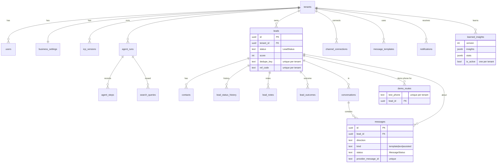

# Models (P0-2)

SQLAlchemy 2.0 typed models, one file per area. `docs/CONTRACTS.md` §3 is the source of truth for every
table and column; this folder implements it.

| File | Tables |
|---|---|
| `base.py` | `Base`, `UUIDPkMixin`, `TimestampMixin`, `TenantMixin` (naming convention for constraints) |
| `enums.py` | every `StrEnum` from §2, `INTENT_TO_STATUS`, `enum_check()` |
| `tenants.py` | `tenants`, `users`, `business_settings` |
| `icp.py` | `icp_versions` |
| `runs.py` | `agent_runs`, `agent_steps` |
| `leads.py` | `search_queries`, `leads`, `contacts`, `lead_status_history`, `lead_notes`, `lead_outcomes` |
| `messaging.py` | `channel_connections`, `message_templates`, `conversations`, `messages`, `demo_routes` |
| `notifications.py` | `notifications`, `learned_insights` |

`knowledge_files` (§3) belongs to P1-1 and is added there.

## Conventions
- `id uuid default gen_random_uuid()` (pgcrypto, migration 0001), `created_at`/`updated_at timestamptz`.
  `updated_at` is maintained by the ORM (`onupdate=func.now()`), not by a DB trigger — raw SQL updates must
  set it themselves.
- Enums are `text` + `CHECK (col IN (...))` generated from the `StrEnum` with `enum_check()`, named
  `ck_<table>_<col>_valid`. Adding an enum value = edit `enums.py` + a migration that recreates the CHECK.
- Tenant-scoped tables use `TenantMixin` (`tenant_id` FK → tenants, `ON DELETE CASCADE`, indexed). Query them
  with a tenant filter; `app.core.tenancy.scoped(stmt, Model, tenant_id)` adds it.
- Lead status changes only through `app.core.lead_state.transition(...)` (writes `lead_status_history`).
- Secrets (channel tokens) are stored with `app.core.crypto.encrypt_json`.
- The TS mirror of the enums is generated by `scripts/export_enums.py` (D commits `frontend/src/lib/types.ts`).

## Migrations
`0001` pgcrypto · `0002` tenants + runs · `0003` business_settings + icp_versions · `0004` search_queries ·
`0005` leads, contacts, messaging, notifications · `0006` users, lead_notes, lead_outcomes, demo_routes,
learned_insights. `uv run poe migrate` applies them; `alembic downgrade base` reverses them.

## ER summary

